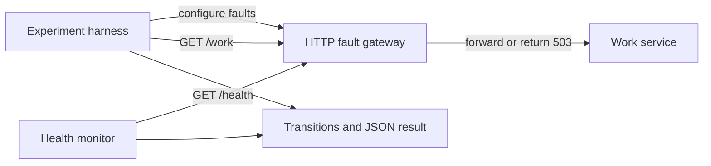

# Linux Network Reliability Lab

[](https://github.com/jyotirawattech/linux-network-reliability-lab/actions/workflows/ci.yml)

How quickly does a health monitor notice a failure, and how quickly does it notice
that service has returned? This small, reproducible lab makes those decisions
visible with a Python HTTP service, a programmable fault gateway, and a monitor
that requires consecutive samples before changing state.

Run it locally to inject delay, reject every third request, simulate an outage,
and measure the monitor's response. All traffic is synthetic and stays on
`127.0.0.1`. The project contains original example code and no employer or customer
code, architecture, logs, or metrics.

## One result you can reproduce

In the **7 November 2026 local run**, rejecting every third request produced
**4 HTTP 503 responses out of 12 requests**. Switching to an outage and then
restoring forwarding produced reported state-change timings of **54.13 ms**
to `DEGRADED` and **54.59 ms** back to `HEALTHY`.

Run `make verify` from the repository root. Its JSON output includes the same
fields as this excerpt from that run; exact timing values vary by host load:

```json
{
  "measurements": {
    "failed_requests": 4,
    "loss_requests": 12,
    "outage_detection_ms": 54.13,
    "recovery_detection_ms": 54.59
  },
  "result": "PASS"
}
```

[Inspect the dated run, full output and acceptance checks](docs/results/verification-2026-11-07.md).
The monitor requires two consecutive failures or successes, so an isolated
sample does not change a healthy/degraded state. These are **detection** timings:
the harness restores forwarding; the monitor does not repair the service.
The reported timestamp is the start of the qualifying probe, not the time its
response completes. HTTP 503 rejection is application-layer behavior, not kernel
packet loss.

## Try the complete experiment

Requires Python 3.11+ and `make`. No third-party Python packages, cloud account,
containers, or root privileges are needed.

```bash
git clone https://github.com/jyotirawattech/linux-network-reliability-lab.git
cd linux-network-reliability-lab
make verify
```

The command runs the tests, enforces an 80% statement-line coverage floor, then
prints a JSON experiment result and writes `docs/results/latest.json`. The
temporary service and gateway stop when the experiment exits. This is a terminal
experiment; it does not leave a dashboard or public endpoint running.

## What the lab demonstrates

| Scenario | Mechanism | Acceptance check |
|---|---|---|
| Delay | Add 120 ms before forwarding seven requests | Added median latency of at least 100 ms |
| Deterministic request rejection | Return HTTP 503 for every third of 12 requests | Exactly four failed requests |
| Outage detection | Reject all requests after the monitor is healthy | Transition to `DEGRADED` in under 300 ms |
| Restoration detection | Restore forwarding after degradation | Transition back to `HEALTHY` in under 300 ms |

The monitor uses a 50 ms pause between samples, a 250 ms probe timeout, two
consecutive failures to declare degradation, and two consecutive successes to
declare health. A passing probe resets the failure count, and a failing probe
resets the success count. The monitor observes the service; the harness clears
the injected outage. There is no automatic repair or failover in this version.



## Verified results

The [original local record](docs/results/verification-2026-09-02.md) and
[public CI run for commit 10f369c](https://github.com/jyotirawattech/linux-network-reliability-lab/actions/runs/33557893891)
provide reproducible evidence. That CI run passed on Python 3.11 and 3.13 and
published one results artifact per Python version.

A fresh local verification on **1 November 2026**, using **macOS 27.2 and
Python 3.14.3**, passed all nine tests and the coverage gate:

| Measurement | Observed in that local run |
|---|---:|
| Statement-line coverage | 184/226 lines (81.4%) |
| Baseline median latency | 1.34 ms |
| Median latency with delay | 126.99 ms |
| Added median latency | 125.65 ms |
| Rejected requests | 4/12 (33.33%) |
| Reported outage detection | 56.01 ms |
| Reported restoration detection | 56.23 ms |

Timings vary with host load. They describe this synthetic localhost run, rather
than a production SLO or a Linux kernel packet-loss test. Transition timings use
the start timestamp of the qualifying probe; see the
[walkthrough](docs/walkthrough.md#interpret-the-timing-carefully) for the exact
measurement boundary.

## Read the engineering decisions

- [Walkthrough: run, inspect, and troubleshoot the experiment](docs/walkthrough.md)
- [Architecture and failure flow](docs/architecture.md)
- [ADR 0001: why portable deterministic faults](docs/adr/0001-portable-deterministic-faults.md)
- [Leadership memo: priorities, trade-offs, and release plan](docs/leadership-memo.md)
- [Tests and acceptance checks](tests/test_lab.py)
- [Candidate execution plan](docs/candidate-execution-plan.md)

## Compare alert noise against detection delay

Run `make compare-policies` for an offline experiment using the actual monitor on
identical synthetic observations. A 1/1 threshold policy produces two noise-induced
degradation events on the isolated-glitch trace; 2/2 and 3/3 produce none. Their cost is
50 ms and 100 ms of additional detection delay on the supplied 50 ms grid, and neither
detects the one-sample outage. These are deterministic **sample-time model**
results, not wall-clock measurements or production recommendations.

[Inspect the inputs, worked JSON and trade-offs](docs/experiments/detection-policy-tradeoffs.md).

## Scope and next experiment

The gateway's `loss` mode returns HTTP 503. It does not drop network packets or
model TCP retransmission, kernel queueing, corruption, reordering, or distributed
failure. The nine tests and the custom statement-line coverage metric also do
not establish branch coverage, load capacity, or production availability.

A future Linux experiment can place the service in a network namespace, apply
`tc netem`, and compare kernel-level delay/loss with this gateway model. That
extension is planned, not implemented here.

## Repository map

```text
src/reliability_lab/       service, fault gateway, monitor, experiment
tests/                     nine unit and localhost integration tests
scripts/                   experiment and statement-line coverage runners
docs/                      walkthrough, architecture, decisions, evidence
.github/workflows/ci.yml   Linux CI matrix for Python 3.11 and 3.13
```

## License

[MIT](LICENSE).
