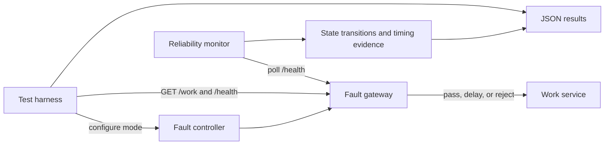

# Architecture and experiment flow

The portable path uses real HTTP traffic over the localhost network stack and a
deterministic application-layer gateway. It runs without root, containers, cloud
accounts, or third-party packages, so the same acceptance experiment can run in
CI and on a laptop.

## Failure scenarios

| Scenario | Portable mechanism | Evidence |
|---|---|---|
| Latency | Add 120 ms before forwarding | Median baseline vs injected latency |
| Request loss | Reject every third request | Exact failed-request count and percentage |
| Service outage | Reject every request | Time to transition from healthy to degraded |
| Recovery | Restore forwarding | Time to transition from degraded to healthy |

The monitor requires two consecutive failures to declare degradation and two
consecutive successes to declare recovery. This reduces flapping at the cost of
slower detection. Both values and the 50 ms polling interval are recorded in the
machine-readable result.

## Linux kernel extension

For a privileged Linux host, the next experiment can place the service in a
network namespace and apply `tc netem` to inject kernel-level delay, random loss,
reordering, duplication, and corruption. That extension is deliberately outside
the default CI path because it needs elevated network administration privileges.
Portable results must not be described as kernel packet-loss results.
